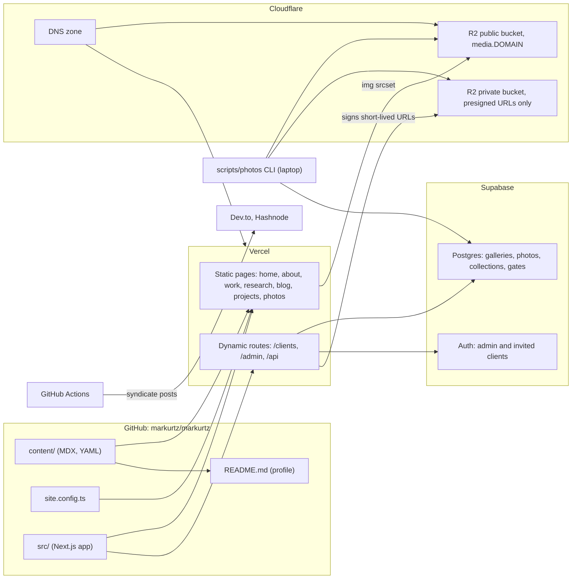

# Personal Website and Profile README: Implementation Plan

| | |
| :--- | :--- |
| **Status** | Proposed, ready to build |
| **Date** | 2026-11-20 |
| **Scope** | The personal website served from this repo, and the GitHub profile `README.md` at the repo root |
| **Audience** | The build thread that implements this, the reviewer, and Mark |

This plan is written to be executed top to bottom. Sections 1 to 4 fix the decisions, sections 5 to 14 specify the design, section 15 is the phased build order with acceptance criteria, and section 17 lists the few things only Mark can do (accounts, DNS, secrets).

Where this plan names a library version, it was checked against the npm registry on 2026-11-20. The builder should still install the latest stable release within the named major and read the current docs for anything marked **verify**, because several of these tools move quickly.

---

## 1. Goals and requirement traceability

Every requirement from the original brief maps to a section and a build phase.

| # | Requirement | Where it is designed | Phase |
| :-- | :--- | :--- | :-- |
| R1 | Own and manage the code, full control to customize anything | §3, §5, §6 | 0 |
| R2 | Easy customization without touching components | §6 (config-driven) | 0 to 2 |
| R3 | About me, hobbies, and work | §7.1, §8 | 2 |
| R4 | Research papers | §7.4, §8 | 2 |
| R5 | Blog: link out to externally hosted posts today | §7.3 (`externalUrl`) | 2 |
| R6 | Blog: self-publish on the site | §7.3, §11 | 2 |
| R7 | Blog: sync to other blogging services | §11 (syndication) | 8 |
| R8 | Coding projects | §7.5 | 2 |
| R9 | DIY and 3D printing projects | §7.5, §7.7 (`ModelViewer`, `BillOfMaterials`) | 2 |
| R10 | Woodworking projects | §7.5, §7.7 | 2 |
| R11 | Photography and travel (public) | §7.6, §10 | 4 |
| R12 | Passcode or login protected areas | §9 | 5 to 6 |
| R13 | Host client shoot images and albums privately | §9, §10 | 6 |
| R14 | Clients create their own collections and share them | §9.5 | 7 |
| R15 | Database-backed customizations, generic passcode pathways | §9.6, §12 | 5, 9 |
| R16 | Domain registered at Squarespace | §13 | 9 |
| R17 | Profile README, since the repo is `markurtz/markurtz` | §14 | 3 |
| R18 | Modern best practices and standards | §4, §16 | all |

Non-goals for the first release: e-commerce or print sales, comments hosted on the site, a newsletter system, multi-author support, and a visual CMS. Section 15 lists these in the backlog with the hook each one would attach to.

---

## 2. Summary of decisions

These are the choices made on Mark's behalf. Each one is reversible, and the "escape hatch" column says how.

| Area | Decision | Why | Escape hatch |
| :--- | :--- | :--- | :--- |
| Framework | Next.js 16 App Router, React 19, TypeScript strict | Matches the suggested stack. Static content pages plus server-side logic for the client area in one codebase. | Avoid Vercel-only APIs so OpenNext on Cloudflare stays possible. |
| Hosting | Vercel with Git integration | Preview deployment per PR, zero-config Next.js. | See the Hobby plan caveat in §13.4. |
| Content engine | **Velite** (not Contentlayer) | Contentlayer is unmaintained. Velite was on the shortlist, is bundler independent (works with Turbopack), uses Zod schemas, and emits typed JSON. | All access goes through `src/lib/content/`, so swapping to Content Collections touches one folder. |
| Styling | Tailwind CSS v4, shadcn/ui components copied into the repo, CSS variable theme tokens | Owned code, no component library lock-in, theme changes in one file. | Components are plain files. |
| Database | Supabase Postgres, accessed **server-side only** through Drizzle ORM | Typed queries, SQL migrations in the repo, and the tests can run against in-process PGlite with no Docker. | Schema is plain Postgres. Any Postgres host works. |
| Auth | Supabase Auth (email one-time code) for the admin and invited clients. A separate signed-cookie grant for passcode access. | Passcode visitors should not need an account. | Auth is isolated in `src/server/auth/`. |
| Media storage | Cloudflare R2, one public bucket and one private bucket, behind a `MediaStorage` interface | Zero egress fees for full-resolution downloads. | Interface has `r2` and `local` drivers. Any S3-compatible store fits. |
| Image processing | Pre-generate derivatives with `sharp` in a CLI at upload time | No per-request image transformation cost, predictable quality, and bulk shoots upload reliably from a laptop. | Browser upload in the admin UI is a later phase using the same pipeline module. |
| DNS | Keep the domain registered at Squarespace, move **nameservers to Cloudflare** (free) | R2 custom domains require the zone to be on Cloudflare. | Records are documented, moving back is a nameserver change. |
| Blog syndication | Site is canonical (POSSE). GitHub Action cross-posts to Dev.to and Hashnode as drafts with `canonical_url` set. Medium, LinkedIn and Substack use their import tools manually. | Those three have no usable publishing API today. | Each target is an adapter file. |
| Profile README | Hand-written `README.md` with generated blocks between markers, checked for drift in CI | Mark edits prose directly. Lists stay in sync with site content with no bot commits. | Delete the markers and it is a static file. |
| Lint and format | Biome | One fast tool. `next lint` no longer exists in Next 16. | If the repo standards thread chose ESLint and Prettier, follow that instead. |
| Tests | Vitest for unit and integration, Playwright for end to end | Standard for this stack. | n/a |
| Package manager | pnpm, pinned through `packageManager` | Fast, strict. | n/a |

---

## 3. Architecture



Three properties drive the layout:

1. **Public content is static and lives in git.** Blog posts, projects, papers and public albums are files. They build to static HTML, need no database, and the site works with every backend feature switched off.
2. **Private content is dynamic and lives in Postgres and R2.** Client galleries change without a deploy and must never be in the static output or the client bundle.
3. **The browser never talks to the database.** All reads and writes go through server components, server actions and route handlers that call a data access layer. Row Level Security is enabled on every table with no public policies, as a second line of defense rather than the primary one.

---

## 4. Stack and versions

Majors confirmed on the npm registry on 2026-11-20.

| Layer | Package | Major | Notes |
| :--- | :--- | :-- | :--- |
| Runtime | Node.js | 22 or newer (`engines`), `.nvmrc` on current LTS | Next 16 needs 20.9 or newer. |
| Framework | `next` | 16 | Turbopack is the default bundler. `middleware.ts` is now `proxy.ts`. Route `params` and `searchParams` are async. **verify** details against current docs. |
| UI | `react`, `react-dom` | 19 | Enable the React Compiler if the Next config flag is stable at build time. |
| Language | `typescript` | latest that Next and Velite both support | TypeScript 7 is current. Fall back one major if any tool fails on it. |
| Styling | `tailwindcss` | 4 | CSS-first config with `@theme`. Add `@tailwindcss/typography` for prose. |
| Components | shadcn/ui (copied), `lucide-react`, `next-themes` | n/a | Only add components that are used. |
| Content | `velite` | 0.4 | Peer-depends on `sharp` 0.34, so pin `sharp` to 0.34.x. |
| MDX plugins | `remark-gfm`, `remark-math`, `rehype-katex`, `rehype-slug`, `rehype-autolink-headings`, `rehype-pretty-code` with `shiki` | n/a | Math and code highlighting at build time, no client JS. |
| Validation | `zod` | 4 | Content schemas come from Velite's `s`. App input and env use Zod directly. |
| Database | `drizzle-orm`, `drizzle-kit`, `postgres` | 0.45 | Use the Supabase transaction pooler URL with `prepare: false`. |
| Test database | `@electric-sql/pglite` | n/a | In-process Postgres for integration tests. |
| Auth | `@supabase/supabase-js` 2, `@supabase/ssr` | n/a | Cookie-based sessions on the server. |
| Sessions | `jose` | 6 | Signs the passcode grant cookie. |
| Storage | `@aws-sdk/client-s3`, `@aws-sdk/s3-request-presigner` | 3 | R2 speaks the S3 API. |
| Images | `sharp` 0.34, `exifr`, `thumbhash` | n/a | Derivatives, EXIF, blur placeholders. |
| Gallery UI | `react-photo-album`, `yet-another-react-lightbox` | 3 | Justified rows layout and lightbox. |
| 3D models | `@google/model-viewer` | 4 | Lazy-loaded web component for `.glb` files. |
| Search | `minisearch` | n/a | Client-side search over a build-time index. |
| Feeds | `feed` | 6 | RSS 2.0, Atom and JSON Feed. |
| Email | `resend` | 6 | Contact form, and as the SMTP provider for Supabase Auth mail. |
| Lint and format | `@biomejs/biome` | 2 | |
| Tests | `vitest` 5, `@playwright/test`, `@axe-core/playwright` | n/a | |
| Scripts | `tsx` | n/a | Runs the TypeScript CLIs in `scripts/`. |

---

## 5. Repository layout

The Next.js app sits at the repo root so Vercel needs no root directory setting and the profile `README.md` stays at the root where GitHub requires it.

```text
.
├── README.md                     # GitHub PROFILE readme (see §14), not project docs
├── site.config.ts                # The one file Mark edits to customize the site (§6)
├── velite.config.ts              # Content collections and schemas (§7)
├── next.config.ts
├── drizzle.config.ts
├── biome.json
├── package.json
├── proxy.ts                      # Auth session refresh for /admin and /clients only
├── content/
│   ├── pages/                    # about.mdx, hobbies.mdx, uses.mdx, now.mdx
│   ├── blog/                     # one .mdx per post, or folder with index.mdx and images
│   ├── papers/                   # one .mdx per publication
│   ├── projects/                 # one folder per project, all categories
│   ├── albums/                   # public photo albums: index.mdx + photos.json
│   ├── data/                     # experience.yaml, education.yaml, talks.yaml
│   └── .syndication.json         # state written by the syndication job (§11)
├── public/
│   ├── models/                   # .glb files for ModelViewer
│   └── static/                   # Velite copies content images here (gitignored)
├── src/
│   ├── app/
│   │   ├── (site)/               # public, static
│   │   │   ├── page.tsx
│   │   │   ├── about/  work/  research/  hobbies/  contact/
│   │   │   ├── blog/  blog/[slug]/  blog/tags/[tag]/
│   │   │   ├── projects/  projects/[slug]/  projects/category/[category]/
│   │   │   └── photos/  photos/[album]/
│   │   ├── (private)/            # dynamic, noindex
│   │   │   ├── clients/                      # enter a code or sign in
│   │   │   ├── clients/g/[slug]/             # gallery
│   │   │   ├── clients/g/[slug]/unlock/
│   │   │   ├── clients/g/[slug]/collections/ # manage collections
│   │   │   ├── clients/c/[token]/            # shared collection
│   │   │   ├── p/[key]/                      # generic gated pages (§9.6)
│   │   │   └── admin/                        # galleries, photos, gates
│   │   ├── api/
│   │   │   ├── health/route.ts
│   │   │   ├── og/route.tsx
│   │   │   └── clients/download/route.ts
│   │   ├── feed.xml/  atom.xml/  feed.json/  llms.txt/
│   │   ├── sitemap.ts  robots.ts  manifest.ts
│   │   ├── layout.tsx  not-found.tsx  error.tsx  global-error.tsx
│   ├── components/
│   │   ├── ui/                   # shadcn primitives
│   │   ├── layout/               # Header, Footer, Nav, ThemeToggle, CommandMenu
│   │   ├── content/              # PostCard, ProjectCard, PaperItem, Timeline, TagList
│   │   ├── mdx/                  # components available inside MDX (§7.7)
│   │   └── gallery/              # PhotoGrid, Lightbox, SelectionBar, PasscodeForm
│   ├── lib/
│   │   ├── content/              # ONLY place that imports from .velite
│   │   ├── seo/                  # metadata builders, JSON-LD
│   │   ├── media/                # public image URL helpers, srcset
│   │   ├── features.ts           # feature flags derived from config and env
│   │   └── env.ts                # Zod-validated environment
│   ├── server/                   # everything here imports "server-only"
│   │   ├── db/                   # schema.ts, client.ts, migrations/
│   │   ├── dal/                  # galleries.ts, photos.ts, collections.ts, gates.ts
│   │   ├── auth/                 # session.ts (grants), supabase.ts, access.ts, passcode.ts
│   │   ├── storage/              # index.ts (interface), r2.ts, local.ts
│   │   ├── rate-limit.ts
│   │   └── actions/              # server actions, one file per feature
│   └── styles/
│       ├── globals.css
│       └── theme.css             # design tokens (§6.3)
├── scripts/
│   ├── photos/                   # upload.ts, pipeline.ts (shared with admin upload)
│   ├── syndicate/                # index.ts, transform.ts, targets/devto.ts, hashnode.ts
│   ├── readme/                   # generate.ts
│   └── new.ts                    # scaffolds a post, project, paper or album
├── tests/
│   ├── unit/  integration/  e2e/
└── docs/
    ├── plans/                    # this file
    └── guides/                   # customizing.md, writing.md, photos.md, client-galleries.md, deploy.md
```

Rules the builder should encode in `AGENTS.md`:

- Only `src/lib/content/` imports from `.velite`. Pages call functions such as `getPosts()` and never touch the raw output.
- Everything under `src/server/` starts with `import "server-only"`.
- Client components never import from `src/server/` and never receive a storage key, only a ready-to-use URL.
- The existing template pieces that do not apply to a website (Python packaging, PyPI publishing, MkDocs, the placeholder `Dockerfile`) are owned by the repo standards thread. This plan assumes they are removed or adapted there and does not depend on any of them.

---

## 6. Config-driven customization

The aim is that routine changes are edits to `site.config.ts`, a content file, or `theme.css`, and never to a component.

### 6.1 `site.config.ts`

A single typed object, validated with Zod at build time so a typo fails the build with a clear message.

```ts
export const siteConfig = defineSiteConfig({
  url: process.env.NEXT_PUBLIC_SITE_URL ?? "http://localhost:3000",
  name: "Mark Kurtz",
  title: "Mark Kurtz",
  tagline: "TODO: one line",
  description: "TODO: two sentences used for SEO and the README",
  locale: "en-US",
  author: { name: "Mark Kurtz", email: "", avatar: "/avatar.jpg", location: "" },

  social: {                       // any subset, rendered in the footer, about page and README
    github: "markurtz",
    linkedin: "", scholar: "", orcid: "", bluesky: "", mastodon: "", x: "", email: "",
  },

  nav: [                          // order and labels of the header
    { label: "About", href: "/about" },
    { label: "Work", href: "/work" },
    { label: "Research", href: "/research" },
    { label: "Blog", href: "/blog" },
    { label: "Projects", href: "/projects" },
    { label: "Photos", href: "/photos" },
  ],

  projectCategories: [            // add a hobby by adding a line here
    { id: "software",    label: "Software",    icon: "code",   description: "" },
    { id: "3d-printing", label: "3D Printing", icon: "box",    description: "" },
    { id: "woodworking", label: "Woodworking", icon: "hammer", description: "" },
    { id: "diy",         label: "DIY",         icon: "wrench", description: "" },
  ],

  home: {                         // which sections appear on the home page, in order
    sections: ["hero", "featuredProjects", "latestPosts", "selectedPapers", "photoStrip"],
    counts: { featuredProjects: 4, latestPosts: 3, selectedPapers: 3 },
  },

  features: {                     // switch whole areas on or off
    blog: true, research: true, photos: true, search: true, contact: false,
    clientGalleries: false,       // also requires the backend env vars (§12.2)
    gatedPages: false,
    comments: false,              // giscus, backlog
    analytics: true,
  },

  blog: { postsPerPage: 10, showReadingTime: true, syndicationTargets: ["devto", "hashnode"] },
  media: { publicBaseUrl: process.env.NEXT_PUBLIC_MEDIA_URL ?? "", widths: [640, 1280, 2560] },
  clientArea: { label: "Client Galleries", defaultExpiryDays: 90, sessionDays: 30 },
});
```

`src/lib/features.ts` combines `siteConfig.features` with the presence of environment variables, so `clientGalleries: true` without database credentials renders a clear "not configured" page in development and fails the production build.

### 6.2 Adding content

`pnpm new post "Title"`, `pnpm new project "Title" --category woodworking`, `pnpm new paper`, and `pnpm new album` scaffold a file with valid front matter. Adding a new project category is one line in `projectCategories`. Its listing page, nav filter and README section follow from the config.

### 6.3 Theme

`src/styles/theme.css` holds all design tokens as CSS variables under `@theme` for light and dark: colors, fonts, radius, content width. Fonts load through `next/font` in `src/app/layout.tsx`. Changing the look of the site is an edit to this one file.

---

## 7. Content model

All collections are defined in `velite.config.ts`. Common fields on every collection: `title`, `description`, `date`, `updated?`, `tags: string[]`, `draft: boolean` (excluded from production builds), `featured: boolean`, `cover?` (image, processed by Velite for dimensions and blur data), plus computed `slug`, `url`, `readingTime` and `toc` where there is a body.

### 7.1 Pages (`content/pages/*.mdx`)

Free-form MDX for About, Hobbies, Uses and Now. The route reads the page by slug, so adding `content/pages/reading.mdx` plus a nav entry creates a new page with no code. The Hobbies page uses a `<CategoryGrid />` MDX component that renders the configured project categories and the photos section, so it stays current as categories are added.

### 7.2 Data (`content/data/*.yaml`)

`experience.yaml` (company, role, start, end, location, summary, highlights, links), `education.yaml`, and `talks.yaml`. The Work page renders a timeline from these. A print stylesheet on `/work` gives a clean one-page resume from the same data.

### 7.3 Blog (`content/blog/`)

```yaml
---
title: "Post title"
description: "One or two sentences."
date: 2026-11-20
tags: [ml, compression]
cover: ./cover.jpg
draft: false
externalUrl:            # set this for posts hosted elsewhere. The card links out and no page is built.
externalSource:         # e.g. "Red Hat Developer", shown as a badge on the card
syndicate: [devto, hashnode]   # overrides blog.syndicationTargets, [] disables
canonicalUrl:           # only when this site is NOT the original home of the post
---
```

This covers both blog modes in the brief. Existing externally hosted posts are small files with `externalUrl` set, so they appear in the list, the feeds and the README immediately. Self-published posts have a body and get a page at `/blog/[slug]`. Syndicated copies are linked from the post footer ("Also published on") using the state file described in §11.

### 7.4 Papers (`content/papers/*.mdx`)

```yaml
---
title: "Paper title"
authors: ["Mark Kurtz", "Coauthor Name"]
venue: "ICML"
year: 2026
date: 2026-07-01
type: conference        # conference | journal | preprint | workshop | thesis | patent | talk
links: { pdf: "", arxiv: "", doi: "", code: "", slides: "", video: "", poster: "" }
abstract: "…"
bibtex:                 # optional. Generated from the fields above when omitted.
featured: true
---
Optional plain-language summary in MDX. When present the paper gets its own page.
```

`/research` lists papers grouped by year with type filters, highlights the site author's name in the author list, and offers a copy-BibTeX button. Paper pages emit `citation_*` meta tags and `ScholarlyArticle` JSON-LD so Google Scholar and other indexers pick them up.

### 7.5 Projects (`content/projects/<slug>/index.mdx`)

One collection covers software, 3D printing, woodworking and DIY. The `category` field must match an id in `siteConfig.projectCategories`, and the build fails on an unknown category.

```yaml
---
title: "Walnut standing desk"
description: "…"
date: 2026-05-01
category: woodworking
status: completed       # idea | in-progress | completed | archived
cover: ./cover.jpg
gallery: [./01.jpg, ./02.jpg]
links: { repo: "", demo: "", docs: "", printables: "", video: "" }
tech: []                # software: languages and frameworks
materials: []           # physical builds: [{ item, quantity, cost?, link? }]
tools: []
buildTime: ""           # e.g. "3 weekends"
difficulty:             # 1 to 5, optional
models: []              # .glb paths under /models for the 3D viewer
featured: true
---
```

Category-specific fields are all optional and the project page renders a section only when its data is present, so one template serves every category. For software projects with `links.repo` set, star count and primary language are fetched from the GitHub API at build time with a long revalidation window and a graceful fallback if the request fails.

### 7.6 Public albums (`content/albums/<slug>/`)

`index.mdx` holds title, date, location, description, cover and optional travel notes as the body. `photos.json` is a manifest written by the photos CLI (§10.3) with one entry per photo: id, width, height, alt, caption, thumbhash and selected EXIF (camera, lens, focal length, aperture, shutter, ISO). The image files themselves are in the public R2 bucket, not in git. Albums have a `kind` of `photography` or `travel` so `/photos` can filter them.

### 7.7 MDX components

Registered once in `src/components/mdx/index.tsx` and available in every MDX file without imports:

| Component | Use |
| :--- | :--- |
| `Callout` | Notes, tips, warnings |
| `Figure` | Image with caption, zoom on click |
| `Gallery` | Grid of local images with the shared lightbox |
| `BeforeAfter` | Draggable comparison slider for builds and photo edits |
| `ModelViewer` | Interactive 3D preview of a `.glb` file, loaded only when scrolled into view |
| `BillOfMaterials` | Table from the project's `materials` front matter, with a cost total |
| `Steps` | Numbered build log steps |
| `GitHubRepo` | Repo card |
| `YouTube`, `Video` | Privacy-friendly lazy embeds |
| `CategoryGrid` | The configured project categories as cards |
| Fenced code, math | Shiki highlighting with titles and line highlights, KaTeX for `$…$` |

Each component also exports a plain Markdown fallback used when a post is syndicated (§11.2).

---

## 8. Routes

| Route | Rendering | Source |
| :--- | :--- | :--- |
| `/` | Static | `siteConfig.home` plus featured content |
| `/about`, `/hobbies`, `/[page]` | Static | `content/pages` |
| `/work` | Static | `content/data` |
| `/research`, `/research/[slug]` | Static | `content/papers` |
| `/blog`, `/blog/[slug]`, `/blog/tags/[tag]` | Static | `content/blog` |
| `/projects`, `/projects/category/[category]`, `/projects/[slug]` | Static | `content/projects` |
| `/photos`, `/photos/[album]` | Static | `content/albums` plus public R2 |
| `/contact` | Static page, server action | Resend, feature flagged |
| `/feed.xml`, `/atom.xml`, `/feed.json` | Static | Blog, with full content for self-hosted posts |
| `/sitemap.xml`, `/robots.txt`, `/llms.txt` | Static | Generated from content, excludes private routes |
| `/api/og` | Dynamic, cached | Open Graph images per page |
| `/clients` and below | Dynamic, `noindex` | Postgres plus private R2 |
| `/p/[key]` | Dynamic, `noindex` | Gated MDX pages |
| `/admin` and below | Dynamic, `noindex` | Admin only |
| `/api/health` | Dynamic | Liveness plus one trivial database query |

All static routes use `generateStaticParams` with `dynamicParams = false` so unknown slugs return a real 404.

---

## 9. Private area: access model

### 9.1 Principals

| Who | How they authenticate | What they can do |
| :--- | :--- | :--- |
| **Admin** (Mark) | Supabase Auth email one-time code. Email must be in `ADMIN_EMAILS`. | Everything under `/admin`. |
| **Passcode visitor** | Enters a gallery passcode. No account. | View that gallery, download if allowed, create and share collections if allowed. |
| **Invited client** | Supabase Auth email one-time code, invited by the admin to specific galleries. Public sign-up is disabled. | Same as a passcode visitor, without typing a code, across all of their galleries at `/clients`. |
| **Share-link visitor** | Opens a collection share URL, optionally enters that collection's passcode. | View, and download if allowed, only the photos in that collection. |

Passcode is the default path because a client should be able to open a link from an email and be looking at photos in seconds. Accounts are optional and invite only.

### 9.2 Database schema

Drizzle schema in `src/server/db/schema.ts`, SQL migrations generated by `drizzle-kit` into `src/server/db/migrations/`. Row Level Security is enabled on every table with no policies for the `anon` or `authenticated` roles, so the Supabase public API exposes nothing. The server connects with the database connection string.

```text
galleries
  id uuid pk, slug text unique, title, description, client_name, shoot_date date,
  cover_photo_id uuid null, status (draft | published | archived),
  passcode_hash text null, access_version int default 1,
  allow_downloads bool, allow_collections bool, expires_at timestamptz null,
  archive_key text null,            -- prebuilt zip of all originals
  created_at, updated_at

photos
  id uuid pk, gallery_id fk on delete cascade, filename, storage_prefix text,
  width int, height int, bytes bigint, content_type, taken_at timestamptz null,
  exif jsonb, thumbhash text, sort_order int, created_at
  index (gallery_id, sort_order)

gallery_members
  gallery_id fk, user_id uuid (auth.users), role (viewer | owner), invited_email, created_at
  primary key (gallery_id, user_id)

collections
  id uuid pk, gallery_id fk on delete cascade, title, description,
  created_by_user uuid null, created_by_name text null,
  share_token_hash text unique, passcode_hash text null,
  allow_downloads bool, expires_at timestamptz null, created_at, updated_at

collection_photos
  collection_id fk on delete cascade, photo_id fk on delete cascade, sort_order int
  primary key (collection_id, photo_id)

gates                               -- generic passcode pathways (§9.6)
  id uuid pk, key text unique, label, passcode_hash, access_version int,
  expires_at timestamptz null, created_at

access_events                       -- audit trail
  id bigserial pk, kind (unlock_ok | unlock_fail | view | download | share_create),
  gallery_id null, collection_id null, gate_id null, ip_hash text, user_agent text, at timestamptz

rate_limits
  key text, window_start timestamptz, count int, primary key (key, window_start)
```

A database constraint guarantees every row in `collection_photos` references a photo in the collection's own gallery, so a collection can never be used to reach photos outside it.

### 9.3 Passcode flow

1. The admin creates a gallery and either types a passcode or generates one (four random words). Only a salted `scrypt` hash from `node:crypto` is stored. The admin UI shows the passcode once, with a copyable link.
2. The visitor opens `/clients/g/<slug>`. Without a valid grant they are sent to `/clients/g/<slug>/unlock`.
3. The unlock server action checks the rate limit (5 failures per 15 minutes per hashed IP and gallery, stored in `rate_limits`), compares in constant time, records an `access_events` row, and on success adds a grant to the session cookie.
4. The session is a JWT signed with `GALLERY_SESSION_SECRET` in a cookie named `__Host-grants`, with `HttpOnly`, `Secure`, `SameSite=Lax` and `Path=/`. Its payload is a list of grants: `{ kind: "gallery" | "collection" | "gate", id, v, exp }`.
5. Every request re-checks the grant against the database: the resource exists, is published, has not expired, and `v` equals the current `access_version`. Changing a passcode increments `access_version`, which revokes every outstanding session for that gallery immediately.

Unknown slugs and wrong passcodes return the same response so gallery names cannot be enumerated.

### 9.4 Authorization in one place

`src/server/auth/access.ts` exports `requireAdmin()`, `requireGalleryAccess(slug)`, `requireCollectionAccess(token)` and `requireGate(key)`. Each returns the resource plus a capability object (`canDownload`, `canManageCollections`) or redirects. Every page, server action and route handler in the private area starts with one of these calls. The data access layer functions take the already-authorized resource id, and a unit test asserts that no file under `src/app/(private)` imports `src/server/db` directly.

### 9.5 Client collections and sharing

Inside a gallery with `allow_collections` on, the visitor can select photos (click, shift-click range, select all), then "Add to collection" to create a new one or append to an existing one. A built-in "Favorites" collection is created on first use so the heart button works with no setup.

Each collection has a share action that produces a URL of the form `/clients/c/<token>`. The token is 32 bytes of randomness, shown once and stored only as a SHA-256 hash. The creator can add an optional passcode, an expiry date, toggle downloads (never more permissive than the parent gallery), rename, reorder, remove photos, regenerate the link, or delete the collection.

Ownership: collections created by a signed-in client belong to that user. Collections created under a passcode session belong to the gallery, and anyone holding the gallery passcode can manage them, which matches how a couple or a family would share one code. The share page shows only the collection's photos and gives no route back into the full gallery. The admin sees every collection per gallery, which doubles as the client's selection list for retouching or prints.

### 9.6 Generic gated pages

The same grant mechanism protects arbitrary content, which is the "passcode style pathways" requirement. An MDX file in `content/private/` with `gate: <key>` in its front matter is served at `/p/<key>` only after `requireGate(key)` passes. These files are compiled by Velite into a separate server-only collection that is never included in `generateStaticParams`, feeds, sitemap or search. Because the repo is public, anything in `content/private/` is still readable on GitHub, so this is for content that is unlisted rather than secret. Truly private text belongs in the database, and the `gates` table plus the admin UI leave room for a `gated_documents` table later.

### 9.7 Admin UI

`/admin` is deliberately small: gallery list and create, gallery detail (settings, passcode, expiry, publish, member invites, photo order, cover selection, delete), the collections for a gallery, gates, and a recent access log. Photo upload in the first release is the CLI in §10.3. Browser upload is in the backlog and reuses the same pipeline module.

---

## 10. Media pipeline

### 10.1 Buckets

| Bucket | Access | Contents |
| :--- | :--- | :--- |
| `PREFIX-public` | Public through the custom domain `media.DOMAIN` with long cache headers | Public album derivatives only. No originals, GPS data stripped. |
| `PREFIX-private` | No public access. Reached only by presigned URLs created on the server. | Client gallery originals and derivatives, zip archives. |

### 10.2 Keys and derivatives

```text
public:   albums/<albumSlug>/<photoId>/<width>.webp          widths from siteConfig.media.widths
private:  galleries/<galleryId>/<photoId>/original.<ext>
          galleries/<galleryId>/<photoId>/preview.webp        2560 px long edge, quality 85
          galleries/<galleryId>/<photoId>/thumb.webp          640 px long edge
          galleries/<galleryId>/archive.zip                   optional, all originals
```

Derivatives are sRGB, auto-rotated, with all metadata stripped. Originals are stored byte for byte. Photo ids are UUIDs, so keys are not guessable even in the public bucket.

### 10.3 Photos CLI

```bash
pnpm photos upload ./exports/smith-wedding --gallery smith-wedding     # private client gallery
pnpm photos upload ./exports/iceland --album iceland-2026              # public album
pnpm photos upload … --dry-run | --concurrency 6 | --archive
```

For each image the shared `pipeline.ts` reads dimensions and EXIF, computes a thumbhash, renders derivatives with `sharp`, uploads through the `MediaStorage` interface, then either inserts `photos` rows (client gallery) or writes `content/albums/<slug>/photos.json` (public album, committed to git). Uploads are idempotent by content hash, so re-running after a failure resumes. `--archive` builds and uploads the full-gallery zip.

### 10.4 `MediaStorage` interface

```ts
interface MediaStorage {
  put(key: string, body: Buffer | Readable, opts: { contentType: string; cacheControl?: string }): Promise<void>;
  signedGetUrl(key: string, opts: { expiresIn: number; downloadAs?: string }): Promise<string>;
  delete(keys: string[]): Promise<void>;
  exists(key: string): Promise<boolean>;
}
```

`STORAGE_DRIVER=r2` uses the S3 client against the R2 endpoint. `STORAGE_DRIVER=local` writes under `.data/media` and serves through a development-only route with HMAC-signed URLs, so the whole client area runs and is tested on a laptop or in CI with no cloud account.

### 10.5 Delivery

- **Public albums:** a `<Photo>` component renders `` with a `srcset` built from the pre-generated widths on `media.DOMAIN`, the thumbhash as a blur placeholder, and explicit width and height to prevent layout shift. It does not use the Vercel image optimizer, so there is no transformation cost.
- **Client galleries:** after the access check, the server component signs thumb and preview URLs for the page (signing is a local HMAC, no network call) with a one hour expiry. Pages are paginated at 200 photos with infinite scroll through a server action.
- **Single download:** `GET /api/clients/download?photo=<id>` re-checks access and `canDownload`, logs the event, and redirects to a five minute presigned URL with an attachment disposition. Bytes go from R2 to the browser, never through Vercel.
- **Download all:** links to the prebuilt `archive.zip` when present.
- **Download a selection or collection:** the browser streams a zip with `client-zip` from presigned URLs, which needs a CORS rule on the private bucket allowing `GET` from the site origin.

---

## 11. Blog publishing and syndication

### 11.1 Publishing on the site

Write `content/blog/my-post.mdx`, open a PR (the Vercel preview shows the rendered post), merge. Drafts (`draft: true`) render in development and previews with a banner and are excluded from production, feeds and the sitemap. A future `date` schedules a post: it is excluded until a daily deploy hook rebuild picks it up.

Feeds: RSS, Atom and JSON Feed with full content for self-hosted posts and link-only entries for external ones. Feeds are the universal sync path, since Substack, Medium and newsletter tools can all import from a URL or feed.

### 11.2 Automated cross-posting

`scripts/syndicate/` runs from `.github/workflows/syndicate.yml`, triggered on pushes to `main` that touch `content/blog/**` and by manual dispatch with a slug and a dry-run toggle.

1. Collect posts that are not drafts, have no `externalUrl`, and list a target that has no entry yet in `content/.syndication.json`.
2. Wait until the canonical URL on the live site returns 200, so the canonical link is valid before any copy exists.
3. Transform the MDX to portable Markdown: remove imports, replace each custom component with its Markdown fallback (§7.7), rewrite relative image and link paths to absolute site URLs, and append "Originally published at <canonical URL>".
4. Call each target adapter.
5. Write the returned ids and URLs to `content/.syndication.json` and open a small PR with that change. The site reads this file to show "Also published on" links, and it is what makes the job idempotent.

| Target | Method | Canonical handling | Default |
| :--- | :--- | :--- | :--- |
| Dev.to | REST API, `DEVTO_API_KEY` | `canonical_url` field | Created as a draft |
| Hashnode | GraphQL API, `HASHNODE_TOKEN` and publication id | `originalArticleURL` | Created as a draft |
| Medium | Manual, using Medium's "Import a story" with the post URL | Medium sets the canonical link on import | Documented step |
| LinkedIn | Manual article or link post | Link back in the first line | Documented step |
| Substack | Manual, or its RSS import | Link back | Documented step |
| Bluesky, Mastodon | Optional announce adapters that post the title and link | n/a | Off |

Cross-posts are created as drafts by default so Mark reviews formatting on each platform before publishing there. Setting `syndication.autoPublish: true` in the config changes that. Updates to an already syndicated post are not pushed automatically. The job prints which copies are now stale. Medium is manual because Medium no longer issues integration tokens for its publishing API, and LinkedIn and Substack have no article API.

---

## 12. Backend wiring

### 12.1 Database and auth clients

- `src/server/db/client.ts`: a single `postgres` client using the Supabase transaction pooler URL with `prepare: false` and a small pool, wrapped by Drizzle.
- `src/server/auth/supabase.ts`: `@supabase/ssr` server client bound to Next cookies, used only for Auth (sign in with a one-time code, read the verified user, admin invites with the secret key).
- `proxy.ts`: refreshes the Supabase session cookie, with a matcher limited to `/admin` and `/clients` so the static site never runs it.
- Supabase project settings: public sign-ups off, email one-time code on, custom SMTP through Resend (the built-in mailer is rate limited to a few messages an hour), site URL and redirect URLs set for production and Vercel previews.

### 12.2 Environment variables

Validated in `src/lib/env.ts`. Only `NEXT_PUBLIC_SITE_URL` is required for the public site. The rest become required when the related feature flag is on. `.env.example` is rewritten to list exactly these.

| Variable | Scope | Needed for |
| :--- | :--- | :--- |
| `NEXT_PUBLIC_SITE_URL` | public | Canonical URLs, feeds, Open Graph |
| `NEXT_PUBLIC_MEDIA_URL` | public | Public album images |
| `DATABASE_URL` | server | Drizzle (pooler URL) |
| `DATABASE_URL_DIRECT` | CI only | Migrations |
| `NEXT_PUBLIC_SUPABASE_URL`, `NEXT_PUBLIC_SUPABASE_PUBLISHABLE_KEY` | public | Auth |
| `SUPABASE_SECRET_KEY` | server | Admin invites |
| `ADMIN_EMAILS` | server | Admin allowlist |
| `GALLERY_SESSION_SECRET` | server | Grant cookie signing, 32 bytes or more |
| `IP_HASH_SALT` | server | Hashing IPs in logs and rate limits |
| `STORAGE_DRIVER` | server | `r2` or `local` |
| `R2_ACCOUNT_ID`, `R2_ACCESS_KEY_ID`, `R2_SECRET_ACCESS_KEY`, `R2_PUBLIC_BUCKET`, `R2_PRIVATE_BUCKET` | server and CLI | Media |
| `RESEND_API_KEY`, `CONTACT_TO_EMAIL` | server | Contact form |
| `GITHUB_TOKEN` | build, optional | Higher rate limit for repo stats |
| `DEVTO_API_KEY`, `HASHNODE_TOKEN`, `HASHNODE_PUBLICATION_ID` | GitHub Actions secrets only | Syndication |

### 12.3 Keeping the free Supabase project awake

Free Supabase projects pause after about a week without activity. A scheduled GitHub Action calls `/api/health` daily, which runs `select 1`. The same workflow doubles as an uptime check and fails loudly if the site or database is down. Upgrading to the paid tier removes the need for it.

---

## 13. Domain, DNS and hosting

### 13.1 Recommended setup

Keep the domain registered at Squarespace and point its nameservers at Cloudflare's free plan. This is required for the `media.DOMAIN` custom domain on R2 and gives one place to manage records.

1. Add the domain as a site in Cloudflare (free plan). Cloudflare scans and imports the existing records. **Check that any email records (MX, SPF, DKIM, DMARC) were imported before continuing**, because mail breaks if they are missed.
2. In Squarespace, open the domain's DNS settings, turn off DNSSEC if it is on, and replace the nameservers with the two Cloudflare assigns. Propagation usually takes under an hour and can take up to a day.
3. In Vercel, add the apex domain and `www` to the project under Settings, Domains. Vercel shows the exact records to create.
4. In Cloudflare DNS, create those records with the proxy **off** (grey cloud, "DNS only"). Typically an `A` record on `@` and a `CNAME` on `www`. Vercel issues the TLS certificates.
5. In Vercel, set the apex as primary and `www` to redirect to it.
6. In Cloudflare R2, connect `media.DOMAIN` to the public bucket. Cloudflare creates that record itself, proxied.
7. For Resend, add the DKIM and SPF records it lists on a `send` subdomain.
8. Any additional domains Mark owns can be added to the Vercel project as redirects to the primary.

### 13.2 Alternative without moving nameservers

Add the Vercel `A` and `CNAME` records directly in Squarespace's custom DNS records. The site works, but R2 cannot serve from a custom domain. Public album images would then have to come from the rate-limited `r2.dev` address, which Cloudflare does not support for production. This is why §13.1 is the recommendation.

### 13.3 Deployments

Vercel's Git integration builds a preview for every PR and production on merge to `main`. Environment variables are set per environment in Vercel. Database migrations run from a GitHub Actions workflow (`db-migrate.yml`) on changes under `src/server/db/migrations/**` on `main`, gated by a protected `production` environment so Mark approves each one.

### 13.4 Plan and cost caveats

| Service | Free tier fits? | Notes |
| :--- | :--- | :--- |
| Vercel | Yes for a personal site | The Hobby plan is for non-commercial use. Delivering paid client shoots through the site is arguably commercial, which would mean Pro at about $20 a month. Mark should decide this before promoting client galleries. Hosting on Cloudflare through OpenNext is the alternative with no such restriction. |
| Supabase | Yes | Pauses when idle (§12.3). No automated backups on free, so a weekly `pg_dump` workflow that stores an encrypted artifact is in Phase 9. Pro is about $25 a month. |
| Cloudflare R2 | First 10 GB free | About $0.015 per GB per month after that and no egress fee. 200 GB of shoots is roughly $3 a month. |
| Cloudflare DNS | Yes | |
| Resend | Yes | 3,000 emails a month on free. |

R2 is delivery storage, not a backup. Originals should remain in Mark's own archive.

---

## 14. GitHub profile README

Because the repo is `markurtz/markurtz`, GitHub renders the root `README.md` on Mark's profile page. The repo must be public and the file must be at the root. So the root README is written for profile visitors, and repository documentation lives in `DEVELOPING.md` and `docs/`, linked from one line at the bottom.

### 14.1 Structure

```markdown
<picture> light and dark banner or wordmark from .github/profile/ </picture>

### Hi, I'm Mark

Two or three sentences: what I do, what I'm focused on now. (hand-written)

[Website](…) · [Blog](…) · [Research](…) · [LinkedIn](…) · [Scholar](…)
<!-- BEGIN:links --> … <!-- END:links -->

#### Featured projects
<!-- BEGIN:projects --> … <!-- END:projects -->

#### Latest writing
<!-- BEGIN:posts --> … <!-- END:posts -->

#### Selected publications
<!-- BEGIN:papers --> … <!-- END:papers -->

#### Beyond work
One line linking to woodworking, 3D printing and photography on the site. (hand-written)

<sub>This repo is also the source of my website. See DEVELOPING.md.</sub>
```

### 14.2 How it stays current and customizable

- Mark edits everything outside the markers directly in `README.md`. There is no separate template file to learn.
- `pnpm readme:generate` (`scripts/readme/generate.ts`) rewrites only the text between `BEGIN` and `END` markers from the same content the site uses: `featured` projects, the newest posts including external ones, `featured` papers, and `siteConfig.social`. Counts and section order come from a `readme` block in `site.config.ts`. Removing a marker pair removes that section for good.
- `pnpm readme:check` runs in CI and fails if the README is out of date, so the profile cannot drift from the site and no bot needs write access to `main`. A pre-commit hook runs the generator when content changes.
- Links are absolute URLs to the live site. Output is deterministic, with no timestamps, so there are no noisy diffs.

### 14.3 Standards for the profile

- Short enough to read in one screen. Lists are capped at about five items.
- Light and dark images through `<picture>` with `prefers-color-scheme`, stored in `.github/profile/`, each with alt text.
- Only HTML that GitHub's sanitizer allows. No scripts, no inline styles.
- No third-party stats or streak widgets by default. They depend on external services that are often down or rate limited, and they add no information a visitor needs. One can be added later as a hand-written line.
- Set the repo's website field to the site URL and add topics, so the repo page links to the site.

---

## 15. Build phases

Each phase is a mergeable increment that leaves `main` deployable. A phase is done when its acceptance criteria pass along with `pnpm check` (Biome, `tsc --noEmit`, unit tests) and `pnpm build`.

### Phase 0: Foundations

- Scaffold Next.js 16 at the repo root with TypeScript strict, Tailwind v4, Biome, Vitest and Playwright. Pin `packageManager` and add `.nvmrc`.
- Add `site.config.ts` with `defineSiteConfig` and its Zod schema, `src/lib/env.ts`, `src/lib/features.ts`.
- Rewrite `.env.example`, `AGENTS.md` commands and layout rules, and `DEVELOPING.md` for this stack. Coordinate with whatever the repo standards thread has landed rather than duplicating it.
- CI on pull requests: install with a frozen lockfile, Biome, type check, unit tests, build. Reuse the existing reusable workflow files where they fit.
- Scripts in `package.json`: `dev`, `build`, `start`, `check`, `lint`, `format`, `typecheck`, `test`, `test:e2e`, `content`, `new`, `photos`, `readme:generate`, `readme:check`, `db:generate`, `db:migrate`, `db:studio`.

**Done when:** a placeholder home page builds and CI is green.

### Phase 1: Design system and layout

- `theme.css` tokens, light and dark themes with `next-themes`, fonts through `next/font`.
- Header with config-driven nav and a mobile menu, footer with social links, skip link, 404 and error pages.
- shadcn primitives actually needed: button, card, badge, dialog, dropdown, input, tabs, tooltip, sheet.
- Root metadata, Open Graph image route, favicon and manifest.

**Done when:** the shell is responsive from 320 px, keyboard navigable, and passes axe with no violations.

### Phase 2: Content engine and core pages

- `velite.config.ts` with all collections from §7, wired into `next.config.ts` so it runs in dev (watch) and build.
- `src/lib/content/` accessors: `getPosts`, `getPost`, `getProjects`, `getProjectsByCategory`, `getPapers`, `getAlbums`, `getPage`, `getTags`, with draft filtering.
- MDX renderer and the components in §7.7.
- Pages: home sections, about, hobbies, work, research, blog list with tags and pagination, post page with table of contents and previous and next links, projects list with category filter, project page, generic `[page]`.
- Feeds, sitemap, robots, `llms.txt`, JSON-LD (`Person`, `WebSite`, `BlogPosting`, `ScholarlyArticle`, `CreativeWork`, `BreadcrumbList`).
- Search: build-time index and a command menu using MiniSearch.
- `pnpm new` scaffolder.
- Seed content: one real or clearly marked sample entry per collection and category, including one external blog post and one project with a 3D model, so every template is exercised. Mark the samples with `TODO` so they are easy to find and replace.

**Done when:** every route in §8's static list renders from content alone, an invalid front matter field fails the build with a readable error, and unit tests cover the accessors and schema edge cases.

### Phase 3: Profile README

- Replace the template `README.md` with the structure in §14.1, with placeholder prose marked `TODO` for Mark.
- `scripts/readme/generate.ts`, `readme:check` in CI, banner images in `.github/profile/`.

**Done when:** running the generator twice produces no diff, and changing a featured project changes the README block.

### Phase 4: Public photography

- `MediaStorage` interface with `local` and `r2` drivers.
- `scripts/photos` pipeline and CLI for `--album`.
- `<Photo>`, `PhotoGrid` and the lightbox, `/photos` and `/photos/[album]` with EXIF captions and keyboard navigation.
- Sample album using the local driver with a few license-free images, so the pages build without R2.

**Done when:** an album uploaded with the CLI appears on the site with responsive images and blur placeholders, and Lighthouse reports no layout shift on the album page.

### Phase 5: Backend foundation

- Drizzle schema and first migration for all tables in §9.2, with Row Level Security enabled.
- Database client, Supabase Auth server client, `proxy.ts`.
- Passcode hashing, grant session cookie, rate limiter, `access.ts` guards.
- `/admin` sign-in with one-time code and the allowlist, admin layout.
- `/api/health`.
- Integration test harness on PGlite that applies the real migrations.

**Done when:** the admin can sign in locally, the guards have unit tests for every allow and deny path including revoked and expired grants, and the public site still builds with all backend variables unset.

### Phase 6: Client galleries

- Admin: gallery create, edit, passcode set and rotate, publish, expiry, delete (which also deletes storage objects).
- Photos CLI `--gallery` mode and `--archive`.
- `/clients` landing (enter a code, or sign in), unlock page, gallery page with signed URLs, lightbox, single download, download all.
- Access logging and the admin log view.
- `noindex` headers, `Referrer-Policy: no-referrer` and `Cache-Control: private, no-store` on everything under `(private)`.

**Done when:** a Playwright test covers wrong passcode, lockout, success, viewing, download, passcode rotation revoking the session, and expiry. A test confirms no storage key or other gallery's data appears in the page payload.

### Phase 7: Collections, sharing and client accounts

- Selection UI, favorites, create and edit collections, reorder.
- Share links with optional passcode and expiry, `/clients/c/[token]`, regenerate and revoke.
- Selection and collection zip download in the browser.
- Admin invites to galleries, `/clients` dashboard for signed-in clients, admin view of collections per gallery.

**Done when:** end to end tests show a passcode visitor creating a collection, a second browser opening the share link and seeing only those photos, and the link failing after revoke. An integration test proves a collection cannot include a photo from another gallery.

### Phase 8: Blog syndication

- Transformer with component fallbacks and absolute URLs, with snapshot tests.
- Dev.to and Hashnode adapters, tested against recorded responses.
- `syndicate.yml` with dry run, the state file, and "Also published on" links on posts.
- `docs/guides/writing.md` covering the manual steps for Medium, LinkedIn and Substack.

**Done when:** a dry run prints the exact payloads for a sample post, and a second run after a simulated success does nothing.

### Phase 9: Hardening and launch

- Security headers in `next.config.ts`: HSTS, `X-Content-Type-Options`, `Referrer-Policy`, `Permissions-Policy`, frame restrictions, and a Content Security Policy shipped in report-only mode first, then enforced.
- Generic gated pages (§9.6) and the gates admin.
- Contact form with Resend, a honeypot field and rate limiting.
- Vercel Web Analytics and Speed Insights behind the feature flag. Both are cookieless, so no consent banner is needed.
- Privacy page describing what the client area stores and for how long. Scheduled job that archives expired galleries.
- Keep-alive and uptime workflow, weekly database backup workflow, Dependabot for npm and Actions.
- Accessibility pass to WCAG 2.2 AA and a performance budget: Lighthouse 95 or higher on home, a post, and an album.
- Guides in `docs/guides/`: customizing, writing, photos, client galleries, deploy and DNS.
- Go-live checklist from §17.

### Backlog (designed for, not built)

| Item | Where it attaches |
| :--- | :--- |
| Browser upload in admin | Presigned multipart upload to R2, then `pipeline.ts` in a server function |
| Watermarked previews, proofing workflow, print orders | New derivative in the pipeline, status column on `collections` |
| Comments | giscus component behind `features.comments` |
| Newsletter | RSS-to-email service pointed at `/feed.xml` |
| Webmentions and social reply counts | Section on the post page |
| Travel map | Album `location` coordinates on a map component |
| Publication import from ORCID or Semantic Scholar | Script that writes `content/papers` files |
| Database-backed private documents | `gated_documents` table next to `gates` |
| Internationalization | Not planned |

### Guidance for the build thread

- Everything through Phase 9 can be implemented and tested without any cloud credentials: the content site is static, storage has the local driver, and database tests use PGlite. End to end tests for the client area need a real Postgres, so make them skip cleanly when `DATABASE_URL` is unset and run them in CI against a Postgres service container.
- If the full plan is delivered as one diff, keep one commit per phase in the order above so the review can follow it.
- Do not put Mark's real biography, employer history or publication list in from memory or guesswork. Use `TODO` placeholders and clearly labelled samples. Facts about Mark come from Mark.
- Do not create cloud resources, change DNS, or add secrets. Those are in §17.

---

## 16. Quality standards

| Area | Standard |
| :--- | :--- |
| TypeScript | `strict`, `noUncheckedIndexedAccess`, no `any` without a comment explaining why |
| Server and client boundary | Server components by default. `"use client"` only for interactivity. `server-only` on all of `src/server`. |
| Input handling | Every server action and route handler parses input with Zod and calls an access guard first |
| Secrets | Only in Vercel and GitHub encrypted settings. Nothing sensitive in `NEXT_PUBLIC_*`. |
| Passcodes and tokens | Stored only as hashes. Constant-time comparison. Rate limited. Tokens have at least 128 bits of entropy. |
| Privacy | IP addresses stored only as salted hashes. GPS data stripped from all derivatives. Private routes are `noindex` and `no-store`. |
| Accessibility | WCAG 2.2 AA. Semantic landmarks, visible focus, `prefers-reduced-motion` respected, alt text required by the content schema for cover images. Lightbox is fully keyboard operable. |
| Performance | Static by default, no client JavaScript for content that does not need it, explicit image dimensions, fonts self-hosted through `next/font` |
| SEO | Canonical URL on every page, Open Graph and Twitter cards, JSON-LD, sitemap, feeds linked from `<head>` |
| Testing | Unit tests for pure logic, integration tests for the data access layer and guards, end to end tests for the critical flows named in each phase |
| Commits and PRs | Conventional Commits, PR template from this repo, CI green before merge |
| Dependencies | Lockfile committed, Dependabot grouped weekly updates, no dependency added for something achievable in a few lines |

---

## 17. What only Mark can do

None of these block building. They block going live.

1. **Confirm the primary domain** and set `NEXT_PUBLIC_SITE_URL`.
2. **Vercel:** import the repo as a project, add environment variables, decide between Hobby and Pro (§13.4).
3. **Cloudflare:** create an account, add the domain, switch nameservers at Squarespace (§13.1), create the two R2 buckets and an API token scoped to them, connect `media.DOMAIN`.
4. **Supabase:** create a project, copy the connection strings and keys, turn off public sign-ups, set up Resend as SMTP.
5. **Resend:** verify the sending domain.
6. **Syndication:** create Dev.to and Hashnode API keys and add them as GitHub Actions secrets.
7. **GitHub:** confirm the repo is public, add a `production` environment with required approval for migrations, set the repo website field.
8. **Content:** replace the `TODO` placeholders in `site.config.ts`, `README.md`, `content/pages/about.mdx` and `content/data/`, and add real posts, papers and projects.

## 18. Risks and open questions

| Risk or question | Default taken | Revisit when |
| :--- | :--- | :--- |
| Velite is pre-1.0 with a slow release cadence | Use it, isolated behind `src/lib/content/` | A Next.js or TypeScript release breaks it. Switch to Content Collections. |
| Vercel Hobby and commercial client work | Build on Vercel, flag it | Before sending the first paid client a gallery link |
| The repo is public, so all code and `content/` are public | Client data lives only in Postgres and R2. Nothing private in git. | If Mark wants private drafts, use a private branch or the database |
| Passcode sessions share ownership of collections per gallery | Accepted, matches how clients share a code | A client asks for individual private selections. Invite them to an account. |
| Very large galleries (thousands of photos) | Pagination, prebuilt zip | Zip size exceeds what browsers handle comfortably. Split archives. |
| TypeScript 7 compatibility across tools | Use the newest version that Next and Velite both support | At scaffold time |
| Free Supabase tier limits (pausing, no backups, 500 MB) | Keep-alive and weekly dump workflows | Client area sees regular use. Upgrade. |
