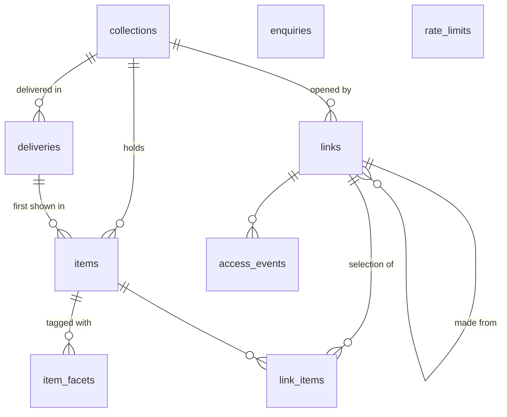

# 11 · Database schema

Status: **Default** design implementing the **Locked** client model of 2026-11-23
([04](../product/04-clients-sharing-embeds.md)). It replaces PR #3's `galleries`,
`gallery_members`, `collections`, `collection_photos` and `gates` tables, and the structure
spec's `access_codes` and `share_links` tables.

Postgres (Supabase), accessed **server-side only** through Drizzle. Row Level Security is enabled
on every table with no policies for `anon` or `authenticated`, so the Supabase public API exposes
nothing; the server connects with the database URL. Migrations are generated by `drizzle-kit` and
committed with the schema change.

## 1. Entities



## 2. Tables

```sql
-- One delivered body of work: a shoot, a film, a set of files.
create table collections (
  id            text primary key,            -- short random id used in /clients/g/<id>/ (10 chars, base62)
  title         text not null,               -- "Smith wedding" (never in an address)
  kind          text not null default 'photo' check (kind in ('photo','film','mixed','files')),
  description   text,
  cover_item_id uuid,
  next_delivery text,                         -- "full reception, about Dec 5"
  status        text not null default 'draft' check (status in ('draft','live','archived')),
  archive_key   text,                         -- prebuilt zip of all originals, private bucket
  created_at    timestamptz not null default now(),
  updated_at    timestamptz not null default now()
);

-- A batch Mark delivers. Items carry the batch they arrived in, which drives "New".
create table deliveries (
  id            bigint generated always as identity primary key,
  collection_id text not null references collections(id) on delete cascade,
  seq           int  not null,               -- 1, 2, 3 per collection
  note          text,
  delivered_at  timestamptz not null default now(),
  unique (collection_id, seq)
);

-- A photo, film or file.
create table items (
  id            uuid primary key default gen_random_uuid(),
  collection_id text not null references collections(id) on delete cascade,
  delivery_id   bigint references deliveries(id),
  kind          text not null check (kind in ('photo','film','file')),
  storage_prefix text not null,              -- private/collections/<cid>/<itemId>/
  filename      text not null,               -- original name, used for downloads
  width int, height int, duration_ms int, bytes bigint not null, content_type text not null,
  taken_at      timestamptz,                 -- capture time: timeline order and moments
  moment        text,                        -- "Ceremony"; groups the rail (else derived by time gaps)
  caption       text,
  alt           text,
  thumbhash     text,
  focus_x real, focus_y real,                -- 0..1, for preview crops
  sort_key      bigint not null,             -- taken_at order, ties by filename
  created_at    timestamptz not null default now()
);
create index items_collection_order on items (collection_id, sort_key);

-- Mark's tags in the five facets. "Delivery: New" is computed, not stored.
create table item_facets (
  item_id uuid not null references items(id) on delete cascade,
  facet   text not null check (facet in ('stage','where','people','type')),
  value   text not null,
  primary key (item_id, facet, value)
);

-- A link: Mark's root link for a collection, or a share made from another link.
create table links (
  id              text primary key,          -- random path id, 12 chars base62 (~71 bits); /s/<id>/
  parent_id       text references links(id) on delete cascade,   -- null = made by Mark
  collection_id   text not null references collections(id) on delete cascade,
  scope           text not null check (scope in ('collection','selection','filter','item')),
  filter          jsonb,                     -- scope='filter': {"stage":["Ceremony"],"people":["Family"]}
  item_id         uuid references items(id) on delete cascade,  -- scope='item'
  name            text not null,             -- "Family", "Photo 12"
  can_download    boolean not null default false,
  can_share_single boolean not null default false,
  can_make_shares boolean not null default false,
  show_preview    boolean not null default true,
  token_version   int not null default 1,    -- bump to invalidate every token ever issued for this link
  expires_at      timestamptz,               -- null = until turned off (P5.7)
  revoked_at      timestamptz,
  revoked_by      text,                      -- 'admin' or the link id that turned it off
  created_at      timestamptz not null default now(),
  last_opened_at  timestamptz,
  open_count      int not null default 0,
  last_seen_delivery int not null default 0, -- New badges: deliveries after this are new to this link
  check ((scope = 'item') = (item_id is not null)),
  check ((scope = 'filter') = (filter is not null))
);
create index links_parent on links (parent_id);
create index links_collection on links (collection_id);

-- Fixed selections (scope='selection').
create table link_items (
  link_id text not null references links(id) on delete cascade,
  item_id uuid not null references items(id) on delete cascade,
  sort    int  not null,
  primary key (link_id, item_id)
);

-- Audit trail. IPs are stored only as a keyed hash.
create table access_events (
  id         bigint generated always as identity primary key,
  at         timestamptz not null default now(),
  kind       text not null check (kind in ('open','open_fail','view','download','download_all',
                                           'link_create','link_turn_off','embed_view','preview')),
  link_id    text references links(id) on delete set null,
  item_id    uuid,
  ip_hash    text,
  user_agent text
);
create index access_events_link on access_events (link_id, at desc);

-- Contact form.
create table enquiries (
  id         bigint generated always as identity primary key,
  at         timestamptz not null default now(),
  name       text not null, email text not null, message text not null,
  source     text,                           -- page the popup was opened from
  ip_hash    text, spam_score real,
  handled_at timestamptz
);

-- Fixed-window counters, updated atomically (see 21 § rate limits).
create table rate_limits (
  key          text not null,                -- 'open:<ipHash>', 'open:<linkId>', 'contact:<ipHash>'
  window_start timestamptz not null,
  count        int not null,
  primary key (key, window_start)
);
```

Every table: `alter table … enable row level security;` with no policies.

## 3. Invariants

| # | Invariant | Enforced by |
| --- | --- | --- |
| I1 | A child link belongs to the same collection as its parent | Trigger `links_same_collection` on insert |
| I2 | A child link never allows more than its parent | Trigger `links_no_escalation` (each `can_*` ≤ parent's) and the API |
| I3 | A child's items are within the parent's items | API check at creation: selection ⊆ parent's effective items; filter = parent filter AND new filter; item ∈ parent's items |
| I4 | `link_items.item_id` and `links.item_id` are in `links.collection_id` | Trigger |
| I5 | Turning off a link turns off its whole subtree | `revoked_at` set on the link; effective state computed through ancestors (below), so descendants need no write |
| I6 | Mark's root links have no parent; client shares always do | Check in the API; `/clients/#` addresses only for roots |

## 4. Effective access

Access for a token is computed on every request from the link and its ancestors:

```sql
with recursive chain as (
  select l.*, 0 as depth from links l where l.id = $1
  union all
  select p.*, c.depth + 1 from links p join chain c on p.id = c.parent_id
)
select
  bool_and(revoked_at is null and (expires_at is null or expires_at > now())) as active,
  bool_and(can_download)     as can_download,
  bool_and(can_share_single) as can_share_single,
  bool_and(can_make_shares)  as can_make_shares
from chain;
```

The visible items are the root link's collection narrowed by each link's scope down the chain
(selection, filter, single item), and only collections with `status = 'live'`. This query lives
in one data-access function, `resolveLink(id, tokenVersion)`, used by every client route
([21](../engineering/21-access-security.md)).

## 5. "New" badges

An item is **New** for a link when `items.delivery_id`'s `seq` is greater than the link's
`last_seen_delivery`. Opening the collection page with that link advances `last_seen_delivery` to
the latest `seq` after the response is sent, so the badges show once.

## 6. Retention

| Data | Kept | Default |
| --- | --- | --- |
| `access_events` | Rolling window | 90 days (**Held**, F61); nightly job deletes older rows |
| `enquiries` | Until handled, then | 1 year |
| `rate_limits` | Expired windows | Deleted hourly |
| Turned-off links | Kept for the access log | Until the collection is archived |
| Archived collections | Originals deleted from storage after | 1 year (Default) |

## 7. Backups

Supabase daily backups (free tier: 7 days). The PR #3 `db-backup.yml` workflow uploaded a dump as
a GitHub Actions artifact, which on a public repository is downloadable by anyone with read
access to the run: **High finding**. Replace it with an encrypted dump (`age` with a public key in
the repo, private key offline) pushed to the private bucket, or drop it and rely on Supabase
backups ([21](../engineering/21-access-security.md#8-review-findings-from-pr-3)).
