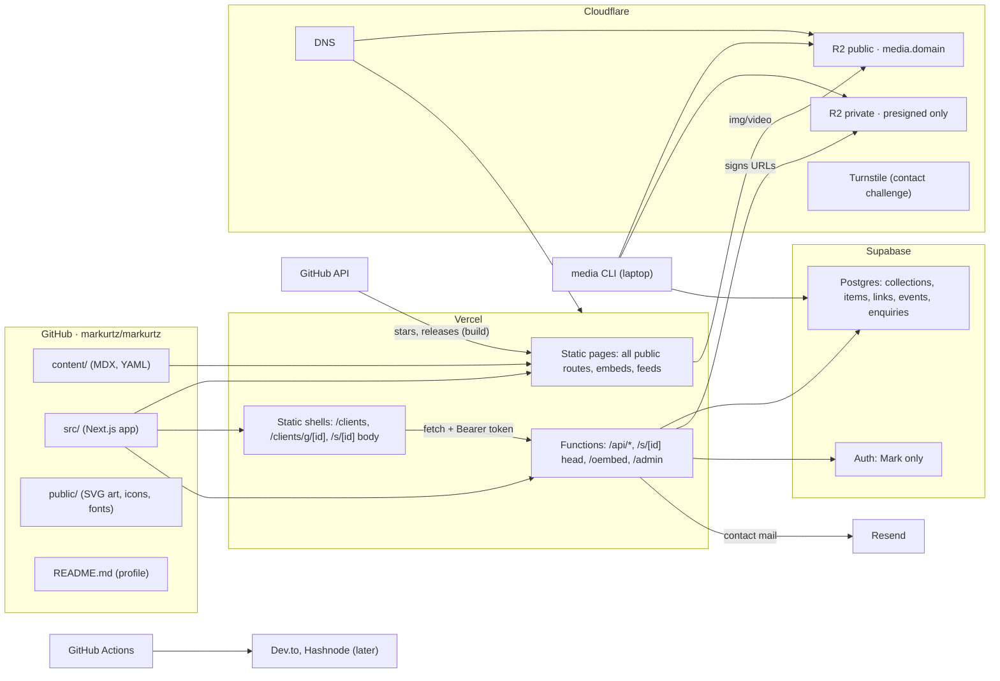

# 20 · System architecture

Status: stack **Locked** by the implementation plan (PR #1) and repo standards (PR #2) unless marked
**Default**. Access model **Locked** 2026-11-23.

## 1. The moving parts



## 2. Properties that drive the design

1. **Public content is static and lives in git.** Every public page, feed and embed is prebuilt
   HTML. The public site works with every backend switched off.
2. **Private content is dynamic and lives in Postgres and the private bucket.** It never enters
   the static output, the client bundle or the repository.
3. **The browser never talks to the database or storage keys.** All reads and writes go through
   route handlers that call one data-access layer after one access check.
4. **The link is the key.** Client pages are static shells. The token arrives after `#`, so the
   server never sees it on navigation; the page script sends it as `Authorization: Bearer` to the
   API, which checks signature and database state on every call ([21](21-access-security.md)).
5. **Progressive enhancement.** HTML carries all content and links; JavaScript adds search,
   filters, the viewer, films, share buttons and art motion. Islands, not a single-page app.

## 3. Stack

| Layer | Choice | Status |
| --- | --- | --- |
| Runtime | Node.js 24 (`.nvmrc`), pnpm pinned | Locked (PR #2) |
| Framework | Next.js 16 App Router, React 19, TypeScript strict | Locked |
| Rendering | Static generation for public routes (`generateStaticParams`, `dynamic = "error"`); route handlers for the API; server components for `/admin` | Locked |
| Content | Velite 0.4 (Zod schemas, typed JSON), behind `src/lib/content/` | Locked |
| Styling | **Port the mock's CSS** (`tokens.css` + `site.css`, split per component) as plain CSS with cascade layers. Tailwind is not needed for the approved look. | **Default** (replaces the plan's Tailwind + shadcn: the mock CSS is the approved design, and a utility rewrite risks drift) |
| Interactivity | Small client components per island (filters, search, viewer, share buttons, contact popup, client app); the page-art runtime (`page-art.js`, `field2.js`, `art-motion.js`) as deferred scripts | Default |
| Search | MiniSearch over a build-time index per list page | Locked (plan) |
| Database | Supabase Postgres via Drizzle ORM; PGlite in tests | Locked |
| Admin auth | Supabase Auth for Mark only (email code or passkey, **Open** D2) | Locked / Open |
| Client tokens | `jose` (JWT, ES256) | Default (format Locked: JWT after `#`) |
| Storage | Cloudflare R2 (public + private) behind `MediaStorage`; `local` driver for dev and CI | Locked |
| Images | `sharp`, `exifr`, `thumbhash` in the CLI; no runtime optimiser | Locked |
| Films | `ffmpeg` in the CLI; native `<video>` | Locked |
| Email | Resend (contact form; admin sign-in mail) | Locked (plan) |
| Spam check | Cloudflare Turnstile (invisible) plus a hidden trap field | Default ("privacy-friendly challenge" Locked) |
| Feeds | `feed` 6 | Locked |
| Lint, format | ESLint + Prettier | Locked (PR #2) |
| Tests | Vitest (unit, integration), Playwright + axe (e2e), Lighthouse CI | Locked |
| Hosting | Vercel (Git integration, preview per PR); Cloudflare DNS; domain registrar unchanged | Locked |

## 4. Rendering modes by route

| Routes | Mode | Why |
| --- | --- | --- |
| `/`, section pages, items, posts, footer pages, `/404`, `/link-expired` | Static | Content in git |
| `/studio/<work>/<n>/`, `/embed/studio/…` | Static | One page per photo, built from `photos.json` |
| Feeds, sitemap, robots, llms.txt | Static (route handlers with `dynamic = "force-static"`) | |
| `/clients/`, `/clients/g/[id]/` | Static shell + client fetch | Token is after `#`; nothing private in HTML |
| `/s/[id]/` | Dynamic `<head>` (og tags by path id, cached 60 s), static body shell + client fetch | Preview bots need per-share tags without the token |
| `/s/[id]/embed/` | Static shell + client fetch | |
| `/api/*`, `/oembed` | Route handlers (Node runtime) | |
| `/admin/*` | Dynamic server components | Mark only |

## 5. Code layout

Follows PR #3's layout and boundary rules (enforced by `tests/unit/boundaries.test.ts`), with
these changes:

```text
src/
  app/
    (site)/                       public pages (static)
      page.tsx  professional/…  workshop/…  studio/[work]/[item]/…  blog/…  about/ uses/ colophon/ privacy/
      link-expired/  not-found.tsx
    embed/studio/[work]/[item]/   bare embed pages
    clients/                      static shells (no (private) group needed: nothing private in HTML)
      page.tsx  g/[id]/page.tsx
    s/[id]/                       share shell + generateMetadata by path id
      page.tsx  embed/page.tsx  og.jpg/route.ts
    admin/                        Mark's area (server components, requireAdmin)
    api/
      links/route.ts              GET resolve current token · POST make a share
      links/[id]/route.ts         PATCH (rename, options) · DELETE (turn off)
      collections/[id]/route.ts   items + signed URLs for the current token
      download/route.ts           single item or zip
      contact/route.ts
    oembed/route.ts
    feed.xml/ atom.xml/ feed.json/ sitemap.ts robots.ts llms.txt/
  components/                     ported from site-mock/src/components.mjs (see 23)
  lib/                            content queries, strings, search index, seo, filters
  server/
    db/ dal/ auth/ storage/ rate-limit.ts tokens.ts access.ts
scripts/media/                    the media CLI
public/art/ public/icons/ public/fonts/
```

Removed from PR #3: `(private)/clients/sign-in`, `clients/g/[slug]/unlock`, `clients/c/[token]`,
`p/[key]`, `gates`, `gallery_members`, invited-client auth, `FEATURE_GATED_PAGES`.

## 6. Trust boundaries

| Boundary | What crosses | Control |
| --- | --- | --- |
| Browser → static pages | Nothing private | Build contains only public content |
| Browser → `/api/*` | Bearer token, JSON | Signature + DB check per request; rate limits; CORS same-origin; no cookies read by the API |
| API → Postgres | Parameterised queries | Server-only module; RLS on with no policies as a second line |
| API → private bucket | Presign requests | Keys never leave the server; URLs live minutes |
| Preview bots → `/s/[id]` | Path id only | Only og tags and a small crop, only if the share is active and allows previews |
| Embeds on other sites → `/embed/…` | Public media | `frame-ancestors *` only on embed routes; everything else `frame-ancestors 'none'` |
| Mark → `/admin` | Supabase session cookie | `requireAdmin()` first in every page and action; allow-list of one email |

## 7. Environments

| Env | Database | Storage | Client tokens | Admin |
| --- | --- | --- | --- | --- |
| Local dev | PGlite | `local` driver | Dev key pair in `.env.local` | Dev sign-in (code `000000`, refused on Vercel) |
| CI / e2e | PGlite, seeded | `local` | Test key pair | Dev sign-in |
| Preview (PRs) | Supabase preview branch or shared staging DB | Staging buckets | Staging key pair | Email code |
| Production | Supabase | R2 | Production key pair (rotatable by `kid`) | Email code / passkey |

Feature switch: `FEATURE_CLIENTS` (was `FEATURE_CLIENT_GALLERIES`) stays **off in production** until
the three High review findings are fixed and verified.
