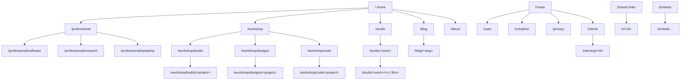

# 02 · Information architecture

Status: **Locked** (site structure locked 2026-11-21; client addresses revised 2026-11-23).

## 1. Site map

Every public page sits at most one level below a menu page, except single projects, works and
photos, which sit one level below their list.

## 2. Navigation

| Place | Contents | Notes |
| --- | --- | --- |
| Site header | Lockup (monogram + "markurtz") · Professional · Workshop · Studio · Blog · About · theme button | Current section: full ink, weight 600, 2 px teal underline on the 68 px bar. Under 760 px the links fold into a menu button. **No Get in touch** (2026-11-23). Transparent over the home hero until scroll. |
| Footer | Invitation "Want to build something together?" + Get in touch · Uses · Colophon · Privacy · Clients · profile icons (GitHub, LinkedIn, Google Scholar, X, Instagram, Reddit, Medium, alphaXiv, RSS) · base row | No Facebook. Page background with a hairline, not navy. |
| Page header | Path title for sub-pages, e.g. **Professional / Software** (option B, 2026-11-23) | Parent part links up. No separate breadcrumb row and no parent links above the title. Also on Studio work and photo pages. |
| Section buttons | Each section page header has a primary and a secondary button (table below) | The primary opens the contact popup. |
| "See all …" | Every home row and blog strip ends with "See all …" | One wording everywhere. |

Section header buttons (Locked 2026-11-22):

| Page | Primary | Secondary |
| --- | --- | --- |
| Professional | Work with me | Download résumé |
| Workshop | Build with me | See my tools → `/uses#uses-woodshop` |
| Studio | Shoot with me (Open: may read as an offer of paid shoots) | See my kit → `/uses#uses-camera-and-editing` |
| Blog | Write with me | Subscribe → RSS |

## 3. Every address

### Public

| Address | Template | Indexed | Notes |
| --- | --- | --- | --- |
| `/` | Home | Yes | |
| `/professional/` | Professional | Yes | Prints as a résumé |
| `/professional/software/` | List | Yes | Items anchor as `#<repo>` |
| `/professional/research/` | List | Yes | Items anchor as `#<id>` |
| `/professional/speaking/` | List | Yes | Items anchor as `#<id>` |
| `/workshop/` | Workshop hub | Yes | Not the list template |
| `/workshop/builds/`, `/designs/`, `/code/` | List | Yes | |
| `/workshop/<page>/<project>/` | Project | Yes | |
| `/studio/` | List | Yes | |
| `/studio/<name-year>/` | Work | Yes | e.g. `/studio/iceland-2025/` |
| `/studio/<work>/<n>/` | Single photo | Yes | `n` counts from 1 in page order |
| `/studio/<work>/film/` | Single film | Yes | |
| `/blog/` | List | Yes | |
| `/blog/<slug>/` | Post | Yes, unless unlisted | |
| `/about/`, `/uses/`, `/colophon/`, `/privacy/` | Simple pages | Yes | Contact popup also at `/about/#contact` and `#contact` anywhere |
| `/404` | Edge | No | Three doors and a search box |
| `/link-expired/` | Edge | No | |
| `/blog/feed.xml`, `/blog/atom.xml`, `/blog/feed.json` | Feeds | — | Hosted and external posts (Open: hosted only?) |
| `/sitemap.xml`, `/robots.txt`, `/llms.txt` | Machine files | — | |
| `/embed/studio/<work>/<n | film>/` | Embed | No (`noindex`) | Framable anywhere |
| `/oembed?url=…` | API | — | Should |

### Private

| Address | Who | Notes |
| --- | --- | --- |
| `/clients/` | Anyone | With no stored link: "Open your photos" with a paste-your-link field. With a stored link: "Your photos". |
| `/clients/#<token>` | Link holder | The link Mark sends. The page stores the token and removes it from the address bar. |
| `/clients/g/<id>/` | Link holder whose link covers it | One collection. `<id>` is a short random id; client and event names never appear in addresses. |
| `/s/<id>/#<token>` | Anyone with the full link | A share: one collection, a selection or one item. The path id lets preview bots unfurl it; the token opens it. |
| `/s/<id>/<n>/` | As above | One item inside a share (Should). |
| `/s/<id>/embed/` | Anyone with the full link | Embeddable view of a share. |
| `/admin/…` | Mark | Separate sign-in (Open: email code or passkey). |

No `/clients/sign-in`, no `/clients/c/<token>`, no `/p/<key>`, no `/now`, no `/work`,
`/projects`, `/photos` or `/contact`. Nothing redirects, because nothing was ever live.

## 4. Query strings

Every narrowed view is a query string on the same page (Locked, P1.1, P1.4, P1.5).

| Key | Meaning | Example | Pages |
| --- | --- | --- | --- |
| `q` | Text search | `?q=sparsity` | All list pages |
| `year` | One year | `?year=2025` | All list pages |
| `kind` | Kind filter | `?kind=library`, `?kind=not-public`, `?kind=conference`, `?kind=preprint`, `?kind=patent`, `?kind=talk`, `?kind=lecture`, `?kind=webinar`, `?kind=podcast` | Software, Research, Speaking |
| `status` | Status filter | `?status=active`, `?status=archived`, `?status=in-progress` | Software, Builds |
| `tag` | Workshop facet | `?tag=video`, `?tag=plans`, `?tag=3d-printing` | Builds, Designs |
| `region` | Studio place | `?region=polar`, `?region=africa-and-middle-east` | Studio |
| `topic` | Free topic tag | `?topic=quantization` | All list pages |
| `role` | Professional role (`org` id) | `?role=neural-magic` | Professional lists |
| `section`, `sub` | Blog section and sub-label | `?section=workshop&sub=builds` | `/blog/` |
| `f` (client) | Facet picks, `facet:value` pairs joined by `,` | `?f=stage:Ceremony,people:Family` | `/clients/g/<id>/` |

Rules: unknown keys are ignored; values are case-insensitive; the canonical URL of a list page is
the bare page (filters are `noindex,follow` through `rel=canonical`); filters update the address
with `history.replaceState`, so back returns to the previous page, not the previous filter.

## 5. Labels

Every item and post has exactly one **section** and one **sub-section**, plus free **topics**.
One shared file, `content/labels.yaml`, holds the names ([10](../data/10-content-model.md#2-labels)).

| Section | Sub-sections |
| --- | --- |
| professional | software, research, speaking, experience |
| workshop | builds, designs, code |
| studio | photo, video, travel, creative |

Topics only ever filter. There are no tag or topic pages.

## 6. User flows

Every public visitor reaches what they came for within three clicks of home.

**Recruiter or engineer.** LinkedIn → `/` → Professional door → reads experience → opens a "Built
here" card under a role → `/professional/research/?role=neural-magic` → "Download résumé" (print)
→ "Work with me" opens the contact popup.

**Event organiser.** A talk link → `/professional/speaking/` → plays a keynote (YouTube loads on
click) → `/about/` → contact popup.

**Researcher.** A citation → `/professional/research/` → `?topic=quantization` or `?year=2022`
→ copies a citation or opens arXiv.

**Maker.** Reddit → `/` → Workshop door → `/workshop/builds/` → a project page → its build log or
time-lapse.

**Photo, film or travel visitor.** Instagram → `/` → Studio door → filters to Polar →
`/studio/antarctica-2024/` → opens photo 3 in the viewer → Copy link
(`/studio/antarctica-2024/3/`) or Embed.

**Returning reader.** Feed reader → `/blog/<slug>/` or the external original → follows its label
to `/blog/?section=workshop`.

**The couple (a wedding client).**
1. Opens the link Mark emailed: `/clients/#<token>`. The browser keeps the token.
2. Lands on "Your photos": what the link lets them do (Download, Share single photos, Make new
   shares) and the gallery "From Mark".
3. Opens `/clients/g/<id>/`, filters to Family, selects all, "Make a link", names it "Family",
   leaves Download off, keeps "Show a preview" on.
4. Sends the new `/s/<id>/#<token>` to relatives. Later turns it off from "Links you've made".

**A wedding guest.** Opens the Family link → sees only those photos, view only → if allowed,
copies a link to a single photo. If the couple turned the link off → `/link-expired/`.

**Someone guessing.** `/clients/g/anything/` or `/s/anything/` without a valid token → the same
"Open your photos" answer as any unknown address; repeated failures are rate-limited.

**Mark delivering a shoot.** `pnpm media upload ./exports/<shoot> --collection <id>` → `/admin`
→ sets the collection's tags and the root link's permissions → copies the link into an email.
Later batches upload to the same collection; they show with a New badge.
